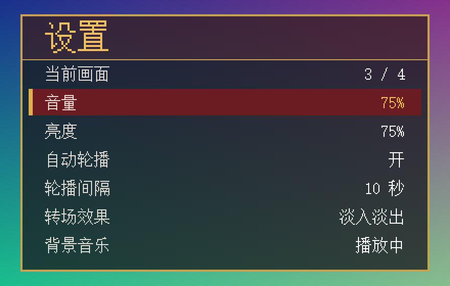

# 设置显示面板

参数变化后，在画面中央弹出设置面板，约 3.5 秒（210 帧）后消失；显示期间再次操作会重新计时。

## 显示内容

| 行 | 内容 | 来源 |
| --- | --- | --- |
| 当前画面 | 1 / 4 ~ 4 / 4 | 当前显示的图片编号（跟随轮播，但不触发面板） |
| 音量 | 0 / 25 / 50 / 75 / 100% | KEY4 短按音量档 |
| 亮度 | 25 / 50 / 75 / 100% | KEY3 长按亮度档 |
| 自动轮播 | 开 / 关 | KEY3 短按 |
| 轮播间隔 | 2 / 5 / 10 / 30 秒 | KEY4 长按周期档 |
| 转场效果 | 淡入淡出 | 固定文字（手动切换淡入淡出，自动轮播为擦除） |
| 背景音乐 | 播放中 / 已暂停 / 提示音 | TF 卡有可用 `MUSIC.WAV` 时为“播放中”，否则为提示音 |

刚改变的那一行用深红底色加金色竖条高亮，值用金色显示。

## 触发规则

- 音量、亮度、自动轮播、轮播间隔四项中任意一项变化，或拨动 SW4 暂停/继续音乐，即触发（每帧比较一次）；SW4 触发时高亮“背景音乐”行。
- 启动页显示期间和之后 60 帧（约 1 秒）内忽略变化，避免上电时从 Flash 载入的参数弹出面板。
- 面板显示期间再次变化：重新计时，高亮行跟随最新变化的那一项。
- 切换图片不触发面板。
- 启动页期间面板不显示。

## 实现

- `rtl/display/settings_panel_overlay.v` 由 `assets/build_settings_panel.py` 生成，不要手工修改；改文案或布局请改生成器后重新运行。
- 文字用 16 像素宋体点阵，拆成 8×16 半字存在 2 块 BRAM 里，汉字占两个半字、ASCII 占一个；标题放大 2 倍。
- 像素按“提前 5 个像素”流水计算，寄存后的结果刚好对齐当前像素，因此不给视频通路增加延迟；
  最终只是在字幕输出后加一级组合选择（面板底色把原画面压暗到 1/4 再叠加，保留半透明效果）。
- 面板位置：左上角 (120, 114)，400×252。

## 验证

`tests/tb_settings_panel.sv`（已加入 `run_boot_title.ps1`）：真实 640×480 时序，检查

- 启动页期间、启用前 60 帧内的参数变化不触发；换图不触发；
- 变化后恰好显示 SHOW_FRAMES 帧，中途再变化重新计时；
- 高亮行跟随变化项（音量、周期、自动轮播各验证一次）；
- 面板以外的像素不被改动。

运行 `vvp <tb>.vvp +dump=<前缀>` 可导出 PPM 画面用于目视检查。

TD 6.2.1 全流程：Setup WNS +0.162 ns，Hold WNS +0.030 ns，TNS 均为 0；LUT 16600/19600（84.7%），BRAM 39/64，DSP 25/29。
尚未实板验证。

## 同时做的时序修复

加入面板后 `bmp24_decoder` 的 BMP 头校验（宽×3→补齐→乘高度→加偏移→比较）成为 mem_clk 关键路径，
改为先用两级寄存器算好 `stride` 与像素数据结束位置，再在第 53 字节校验时直接取用（头字段至少提前 28 拍稳定）。功能不变，原有缩放和错误头测试全部通过。
